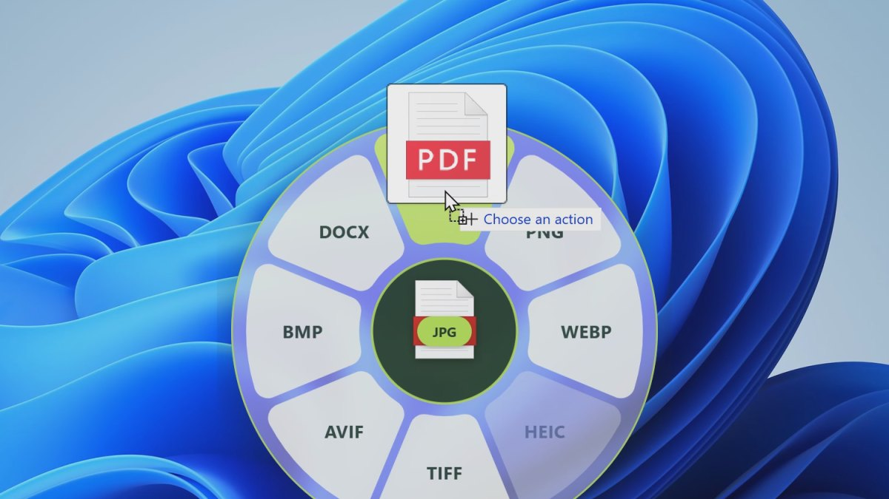

# File Beaver

**Drag a file onto the beaver, get things done.** File Beaver puts a little beaver on your
Windows desktop. Drag any image or PDF onto him and a ring of actions opens around him
(or hold a file anywhere and tap <kbd>Shift</kbd>):




- **Convert** to JPG, PNG, WEBP, HEIC, TIFF, AVIF, BMP, PDF or DOCX
- **Compress** photos and PDFs
- **Remove metadata** (camera details, GPS location, PDF author info) without re-encoding
- **Edit**, **Crop**, **Annotate**, **Add a background**, or **Redact** in a quick editor

Results are saved next to the original. The original is never changed.

Free and open source (MIT). Works offline: File Beaver only goes online to check for updates.

## Install

1. Download **`File.Beaver_x.y.z_x64-setup.exe`** from the
   [latest release](https://github.com/DEVIOUSDEV101/file-beaver/releases/latest).
2. Run it. It installs in a few seconds for your user account only (no admin prompt),
   starts with Windows, and updates itself.

**"Windows protected your PC"?** The installer isn't code-signed yet, so Windows
SmartScreen warns about any new app it hasn't seen many downloads of. Click
**More info**, then **Run anyway**. The source code is all here if you'd rather build it
yourself.

Requires Windows 10 or 11 (64-bit). HEIC needs Microsoft's HEIF and HEVC extensions
from the Microsoft Store; File Beaver greys HEIC out if they're missing.

## How to use

**With the beaver** (he lives on your desktop, behind your windows, and pops up when you
drag a file):

1. Drag any file (from Explorer, the desktop, a browser download) onto the beaver.
2. The ring opens around him. Slide onto an action and let go.
3. Or let go right on the beaver: the ring stays open, then click an action.

**With Shift** (anywhere on screen):

1. Start dragging a file and tap <kbd>Shift</kbd>: the ring opens under your cursor.
2. Drop on an action. Drop in the centre, drag away, or press <kbd>Esc</kbd> to cancel.

Images open on **Tools** (Crop, Add BG…), PDFs on **Convert**. Click the centre, or tap
<kbd>Shift</kbd> again, to switch.

Move the beaver by dragging him; right-click him to hide him (bring him back from the
tray icon). The trigger key (Shift, Ctrl+Shift or Alt) and where results are saved can be
changed in Settings (click the tray icon).

## Privacy

No accounts, no tracking, no uploads. Files are processed on your PC. If File Beaver
crashes, a report is saved locally in `%LOCALAPPDATA%\app.filebeaver.desktop\crashes`;
nothing is sent anywhere.

## Build from source

See [RELEASING.md](RELEASING.md) for the toolchain and release steps, and
[PLAN.md](PLAN.md) for the design and the reasoning behind technical choices.

```
cd core && cargo test          # logic and file-format tests
cd app && npm install && npx tauri build --debug --no-bundle
```

## Credits

Inspired by a radial file tool for macOS. File Beaver is an independent project and is
not affiliated with it. Third-party components and their licences are listed in
[THIRD_PARTY_NOTICES.txt](THIRD_PARTY_NOTICES.txt).

## Licence

[MIT](LICENSE) © 2026 DEVIOUSDEV101
